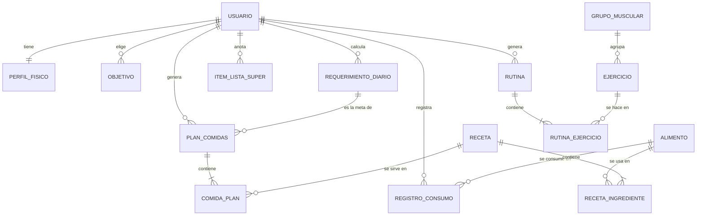

# Solea

**Come y entrena según tu objetivo.** Solea es una aplicación de escritorio en **JavaFX** que calcula
tus calorías y macronutrientes, arma tu plan semanal de comidas, tu lista del súper y tu rutina de
gimnasio. Guarda todo en **PostgreSQL** con **Hibernate ORM**, consulta alimentos reales en internet a
través de su propia **API REST** y exporta reportes en **PDF** con **JasperReports**.

Proyecto final de *Programación de Aplicaciones de Escritorio* — Universidad Americana (UAM), Grupo 6.

---

## Contenido

1. [Descripción](#1-descripción)
2. [Tecnologías y requisitos](#2-tecnologías-y-requisitos)
3. [Preparar la base de datos](#3-preparar-la-base-de-datos)
4. [Ejecutar la aplicación](#4-ejecutar-la-aplicación)
5. [Modelo de datos](#5-modelo-de-datos)
6. [Persistencia: CRUD, transacciones y HQL](#6-persistencia-crud-transacciones-y-hql)
7. [Decisiones de diseño](#7-decisiones-de-diseño)
8. [API REST y reportes PDF](#8-api-rest-y-reportes-pdf)
9. [Evidencias](#9-evidencias)
10. [Estructura del proyecto](#10-estructura-del-proyecto)
11. [Equipo y flujo de trabajo](#11-equipo-y-flujo-de-trabajo)

---

## 1. Descripción

Solea tiene dos modos, cada uno con sus objetivos:

| Modo | Objetivos |
|---|---|
| **Nutrición** | Bajar de peso · Mantener peso · Subir de peso |
| **Gimnasio** | Volumen muscular · Definición · Fuerza · Recomposición corporal · Resistencia muscular · Tonificación |

Con el perfil físico (peso en kg o lb, altura, edad, sexo, nivel de actividad y % de grasa opcional), Solea:

- **Calcula el requerimiento diario**: calorías y gramos de proteínas, carbohidratos y grasas según el objetivo.
- **Registra el consumo** del día y lo compara con la meta. Los alimentos se buscan escribiendo, y si no
  están se pueden traer de **Open Food Facts** (internet) y guardar en la base.
- **Arma un plan semanal de comidas** con recetas que se acercan a la meta de calorías de cada comida.
- **Genera la lista del súper** a partir del plan.
- **Genera la rutina de gimnasio** de 3, 4 o 5 días, con series, repeticiones y descanso según el objetivo.
- **Exporta PDF** de la rutina, la lista del súper y la ficha nutricional.

Viene lista para usar: trae **66 alimentos comunes** (incluidos platos típicos como gallo pinto, plátano,
yuca y tilapia), **16 recetas** sugeridas y **33 ejercicios** en 7 grupos musculares. Las contraseñas se
guardan cifradas y la cuenta se puede recuperar con una **pregunta de seguridad**.

---

## 2. Tecnologías y requisitos

| Herramienta | Versión | Para qué |
|---|---|---|
| JDK | 21 | Lenguaje (con `module-info.java`) |
| JavaFX + FXML | 21 | Interfaz gráfica |
| Hibernate ORM | 6.6 | Persistencia (JPA) sin JDBC directo |
| PostgreSQL | 15 o superior | Base de datos |
| JasperReports | 6.21 | Reportes PDF |
| Spring Boot | 3.4 | API REST (carpeta `api/`) |
| Maven | incluido (`mvnw`) | Construcción y dependencias |
| IntelliJ IDEA | reciente | IDE recomendado |

---

## 3. Preparar la base de datos

1. Abre **pgAdmin** (o `psql`) y crea la base de datos. Se recomienda un usuario propio para la app:

   ```sql
   CREATE ROLE solea WITH LOGIN PASSWORD 'elige_una_contraseña';
   CREATE DATABASE solea_db OWNER solea ENCODING 'UTF8';
   ```

2. **No hace falta crear tablas.** Hibernate las crea solas al abrir la app (`hbm2ddl.auto = update`) y
   Solea carga los alimentos, recetas y ejercicios iniciales.

3. **Configura la conexión sin escribir la contraseña en el código.** `hibernate.cfg.xml` no tiene
   contraseña: se lee de variables de entorno.

   | Variable | Valor por defecto | Ejemplo |
   |---|---|---|
   | `DB_URL` | `jdbc:postgresql://localhost:5432/solea_db` | `jdbc:postgresql://localhost:5433/solea_db` |
   | `DB_USER` | `postgres` | `solea` |
   | `DB_PASSWORD` | *(vacía)* | la contraseña del usuario |

   **IntelliJ:** *Run → Edit Configurations… → Launcher → Environment variables*.
   **PowerShell** (solo para esa terminal): `$env:DB_PASSWORD = "tu_contraseña"`.

Si algo falla, Solea explica el motivo al abrir: contraseña incorrecta, base inexistente o servidor apagado.

---

## 4. Ejecutar la aplicación

**App de escritorio**

- IntelliJ: abre `src/main/java/ni/edu/uam/proyectofinal/Launcher.java` y pulsa ▶ Run.
- Terminal: `./mvnw clean javafx:run`

**API REST** (opcional: búsqueda de alimentos en internet y consejos del día)

- IntelliJ: abre `api/src/main/java/ni/edu/uam/api/SoleaApiApplication.java` y pulsa ▶ Run.
- Terminal: `./mvnw -f api/pom.xml spring-boot:run` → queda en `http://localhost:8080`.

Sin la API la app funciona igual; solo la búsqueda en internet avisa que la API está apagada.

**Pruebas automáticas de la API:** `./mvnw -f api/pom.xml test` (20 pruebas).

**Primer uso:** pulsa *Crear cuenta*, elige tu pregunta de seguridad, completa tu perfil físico, elige un
modo y un objetivo, y pulsa *Calcular requerimiento*.

---

## 5. Modelo de datos

15 entidades JPA, todas registradas en `hibernate.cfg.xml`, con `@Entity`, `@Table`, `@Id`,
`@GeneratedValue` y `@Column` con restricciones (`nullable`, `length`, `unique`). Los nombres de columnas
están en *snake_case* (`CamelCaseToUnderscoresNamingStrategy`).



| Entidad | Tabla | Relaciones |
|---|---|---|
| `Usuario` | `usuarios` | 1:1 `PerfilFisico` (bidireccional, cascade ALL) |
| `PerfilFisico` | `perfiles_fisicos` | 1:1 `Usuario` (lado dueño, `usuario_id` único) |
| `Objetivo` | `objetivos` | N:1 `Usuario` |
| `RequerimientoDiario` | `requerimientos_diarios` | N:1 `Usuario` |
| `Alimento` | `alimentos` | catálogo compartido |
| `RegistroConsumo` | `registros_consumo` | N:1 `Usuario`, N:1 `Alimento` |
| `ItemListaSuper` | `items_lista_super` | N:1 `Usuario` |
| `Receta` | `recetas` | 1:N `RecetaIngrediente` (bidireccional, cascade ALL + orphanRemoval) |
| `RecetaIngrediente` | `receta_ingredientes` | N:1 `Receta`, N:1 `Alimento` |
| `PlanComidas` | `planes_comidas` | N:1 `Usuario`, N:1 `RequerimientoDiario`, 1:N `ComidaPlan` |
| `ComidaPlan` | `comidas_plan` | N:1 `PlanComidas`, N:1 `Receta` |
| `GrupoMuscular` | `grupos_musculares` | 1:N `Ejercicio` (bidireccional, sin cascade) |
| `Ejercicio` | `ejercicios` | N:1 `GrupoMuscular` |
| `Rutina` | `rutinas` | N:1 `Usuario`, 1:N `RutinaEjercicio` (cascade ALL + orphanRemoval) |
| `RutinaEjercicio` | `rutina_ejercicios` | N:1 `Rutina`, N:1 `Ejercicio` |

Las relaciones 1:N bidireccionales usan `mappedBy`, `@JoinColumn` y **métodos de ayuda** que mantienen
los dos lados sincronizados (`Receta.agregarIngrediente`, `Rutina.agregarEjercicio`,
`PlanComidas.agregarComida`, `GrupoMuscular.agregarEjercicio` y sus `remover…`).

---

## 6. Persistencia: CRUD, transacciones y HQL

**CRUD con Hibernate (sin JDBC).** `GenericDAO<T>` implementa `guardar`, `buscarPorId`, `listarTodos`,
`actualizar` y `eliminar` para todas las entidades; cada DAO hereda de él y agrega sus consultas.

**Transacciones.** Cada escritura abre su sesión, hace `commit` si todo sale bien y `rollback` si algo
falla, siempre con la sesión todavía abierta, y la cierra con *try-with-resources*. Ejemplos probados:
una rutina con un dato inválido no queda guardada a medias, y un correo repetido no crea la cuenta.

**Integridad al eliminar.** No se borra un alimento usado en recetas o consumos, una receta usada en un
plan, ni un ejercicio usado en una rutina; la app explica el motivo. Eliminar una cuenta borra todos sus
datos en una sola transacción.

**Consultas HQL** (todas con parámetros con nombre, ninguna concatena valores):

| Consulta | Dónde | Tipo |
|---|---|---|
| Usuario con su perfil al iniciar sesión | `UsuarioDAO.autenticar` | `JOIN FETCH` |
| ¿Ya existe una cuenta con ese correo? | `UsuarioDAO.existeCorreo` | `COUNT` |
| Historial de objetivos con el nombre del usuario | `ObjetivoDAO.listarObjetivosConUsuario` | `JOIN` |
| Calorías y macros consumidos en el día | `RegistroConsumoDAO.obtenerTotales` | `SUM` + `COALESCE` |
| Recetas con ingredientes y alimentos | `RecetaDAO.listarTodas` | `JOIN FETCH` (2 niveles) |
| Kcal y macros de cada receta desde sus ingredientes | `RecetaDAO.obtenerResumenCaloricoRecetas` | `SUM` + `GROUP BY` |
| Último plan con comidas, recetas e ingredientes | `PlanComidasDAO.buscarUltimoPorUsuario` | `JOIN FETCH` + subconsulta |
| Última rutina con ejercicios y grupos musculares | `RutinaDAO.buscarUltimaPorUsuario` | `JOIN FETCH` (3 niveles) |
| Series semanales por grupo muscular | `RutinaDAO.resumenPorGrupoMuscular` | `COUNT` + `SUM` + `GROUP BY` |
| Ejercicios de un grupo muscular | `EjercicioDAO.listarPorGrupo` | `JOIN FETCH` |
| Borrar una cuenta con todos sus datos | `UsuarioDAO.eliminar` | `DELETE` masivo |

---

## 7. Decisiones de diseño

- **Un DAO genérico.** Antes cada DAO repetía el mismo bloque de transacción; además, el patrón
  `try (Session…) {} catch { rollback }` hacía el rollback con la sesión ya cerrada. `GenericDAO`
  centraliza el CRUD y hace el rollback dentro de la sesión abierta.
- **LAZY por defecto y `JOIN FETCH` cuando se necesita.** Las colecciones son LAZY y los DAO traen
  exactamente lo que cada pantalla muestra, así no hay `LazyInitializationException`. Solo son EAGER
  las relaciones a datos pequeños que siempre se muestran (el alimento de un consumo, el grupo de un
  ejercicio) y cada una lo justifica en un comentario.
- **Cascade solo en composiciones.** Los ingredientes, las comidas del plan y los ejercicios de una
  rutina no existen sin su padre (cascade ALL + orphanRemoval). Los catálogos (alimentos, ejercicios)
  no usan cascade para que borrar algo no arrastre datos compartidos.
- **Las reglas del negocio en servicios.** El cálculo (Mifflin-St Jeor o Katch-McArdle si hay % de
  grasa, factor de actividad, ajuste por objetivo y mínimo seguro de calorías), el generador de plan y
  el de rutina están en `service/`, separados de las pantallas.
- **Validación en un solo lugar.** `Validacion` lee y valida cada campo (rangos, largos, números con
  coma o punto, rechaza `NaN`), marca en rojo el campo con error y `Alertas` muestra mensajes claros.
- **Seguridad.** Contraseñas y respuestas de seguridad con hash PBKDF2 y sal aleatoria; las credenciales
  de la base solo en variables de entorno.
- **Conexión que se recupera.** `HibernateUtil` crea la `SessionFactory` cuando se necesita; si
  PostgreSQL no responde explica el motivo y vuelve a intentar, sin dejar la app inservible.
- **API propia entre la app e internet.** La app no llama a Open Food Facts directamente: lo hace la
  API (con tiempo de espera, caché y respaldo local), que además usa las mismas fórmulas de cálculo.

---

## 8. API REST y reportes PDF

**API** (`api/`, Spring Boot). No guarda datos; centraliza la lógica nutricional y consulta internet.

| Método | Ruta | Qué hace |
|---|---|---|
| `GET` | `/api/status` | Comprueba que la API esté activa |
| `GET` | `/api/alimentos/buscar?q=avena&limite=8` | Busca alimentos en Open Food Facts (macros por 100 g) |
| `GET` | `/api/consejos?objetivo=Fuerza` | Consejo nutricional según el objetivo |
| `POST` | `/api/calculo/macros` | Calorías y macros (JSON), mismas fórmulas que la app |

Los datos inválidos responden `400` con el motivo; si Open Food Facts no responde, usa un catálogo local.

**Reportes en PDF y Excel** (JasperReports): rutina de gimnasio agrupada por día, lista del súper y
ficha nutricional, con los botones **Vista previa**, **Exportar PDF** y **Exportar Excel** en cada
pantalla. Detalle en
[`reports/README_REPORTES.md`](src/main/resources/ni/edu/uam/proyectofinal/reports/README_REPORTES.md).

---

## 9. Evidencias

Capturas de la aplicación funcionando con PostgreSQL, en la carpeta [`evidencias/`](evidencias/).

<!-- Las capturas se agregan con el diseño final de la interfaz -->

---

## 10. Estructura del proyecto

```
src/main/java/ni/edu/uam/proyectofinal/
├── controller/   Pantallas JavaFX (login, perfil, cálculo, consumo, recetas, plan, lista, rutina…)
├── dao/          GenericDAO, un DAO por entidad, consultas HQL y datos iniciales
├── model/        Entidades JPA
├── reporte/      ReporteService y filas de los reportes JasperReports
├── service/      Cálculo nutricional, generador de plan y de rutina, cliente de la API
└── util/         HibernateUtil, validación, alertas, navegación, contraseñas y utilidades de pantalla
src/main/resources/
├── hibernate.cfg.xml
└── ni/edu/uam/proyectofinal/
    ├── views/    Vistas FXML y hoja de estilos
    ├── reports/  Plantillas .jrxml
    └── fonts/    Tipografías de la interfaz
api/              API REST en Spring Boot (con sus pruebas)
evidencias/       Capturas de la aplicación
```

---

## 11. Equipo y flujo de trabajo

| Integrante | Módulo |
|---|---|
| Luis Aburto | Base del proyecto, usuarios, perfil, menú, API REST y plantillas de reportes |
| Daris Mayorga | Alimentos, cálculo nutricional, consumo y lista del súper |
| Franklin Callejas | Recetas y plan semanal de comidas |
| Daniella Rocha | Modo gimnasio, integración, persistencia, validaciones y reportes |

- `main` se mantiene estable; cada funcionalidad se trabaja en su propia rama.
- Los cambios entran a `main` mediante **Pull Request** revisado por otro integrante.
- Commits con mensajes descriptivos (`feat:`, `fix:`, `docs:`, `refactor:`).
- No se suben contraseñas ni archivos locales (`.gitignore` excluye `target/`, `.idea/` local y `.env`).
